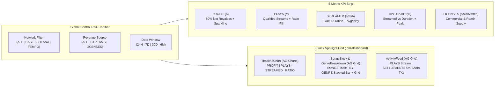

# Rawchunks Earn Charts & AG-Grid Telemetry Suite (`app/src/components/ag`)

Built on **AG Grid Community v35** (`ag-grid-community` / `ag-grid-react`) and **AG Charts Community v13** (`ag-charts-community` / `ag-charts-react`), this module unifies real-time x402 pay-per-stream micro-payments, prepaid card credit holds, and multi-chain commercial/remix license settlements across **Base**, **Solana**, and **Tempo** into a single spotlight-driven analytical workspace.

---

## Table of Contents

1. [What We Built: Product & Analytical Overview](#1-what-we-built-product--analytical-overview)
2. [Module Directory & Component Breakdown](#2-module-directory--component-breakdown)
3. [Backend Databases & Multi-Chain Reconciliation Architecture](#3-backend-databases--multi-chain-reconciliation-architecture)
   - [Database Topology](#31-database-topology)
   - [Schema Specifications (`songs`, `song_earnings`, `wallet_pairs`, `credit_holds`)](#32-schema-specifications)
   - [Atomic Precision, 80/20 Split & Millisecond Metering](#33-atomic-precision-8020-split--millisecond-metering)
   - [Four-Source Reconciliation Engine (`getCreatorEarnings`)](#34-four-source-reconciliation-engine-getcreatorearnings)
   - [Two-Tier L1/L2 Caching & Single-Flight Stampede Protection](#35-two-tier-l1l2-caching--single-flight-stampede-protection)
4. [How We Used AG Grid v35 & AG Charts v13](#4-how-we-used-ag-grid-v35--ag-charts-v13)
   - [Centralized Community Module Registration](#41-centralized-community-module-registration)
   - [Pattern 1: Multi-Column Progressive Data Grid (`SongsBlock`)](#42-pattern-1-multi-column-progressive-data-grid-songsblock)
   - [Pattern 2: Headerless Virtualized Receipt Feed (`ActivityFeed`)](#43-pattern-2-headerless-virtualized-receipt-feed-activityfeed)
   - [Pattern 3: Hybrid Proportional Bar + Focused Detail Grid (`GenreBreakdown`)](#44-pattern-3-hybrid-proportional-bar--focused-detail-grid-genrebreakdown)
   - [Pattern 4: Multi-Series Time-Horizon Canvas (`TimelineChart`)](#45-pattern-4-multi-series-time-horizon-canvas-timelinechart)
   - [Spotlight Layout State Machine & Responsive Breakpoints](#46-spotlight-layout-state-machine--responsive-breakpoints)
   - [Rawchunks Design System & Typography Overrides](#47-rawchunks-design-system--typography-overrides)
5. [Why AG Grid & AG Charts Brought Concrete Production Benefits](#5-why-ag-grid--ag-charts-brought-concrete-production-benefits)

---

## 1. What We Built: Product & Analytical Overview

In **`/my-page > EARN`**, creators can toggle between two complementary views of their published catalog:
- **`LISTS`**: A release management table for editing track terms, inspecting license supply, and triggering quick actions.
- **`CHARTS`** (`app/src/components/ag`): A high-density, real-time telemetry command center that answers four critical creator questions:
  1. **How much net profit am I earning over time, and from which revenue streams?** (`PROFIT` — net 80% creator royalties vs. 20% platform fee, filterable by `ALL SOURCES`, `STREAMS`, or `LICENSES`).
  2. **Which tracks drive qualified play volume vs. exact listening duration?** (`PLAYS` vs. `STREAMED` — distinguishing qualified plays of $\ge 30\text{s}$ from the **exact millisecond duration** a track has been streamed, segmented by **Top 3 Songs + Others**).
  3. **How deeply are listeners engaging with each song?** (`RATIO` — the percentage of a song's total duration streamed per play, plotted against the catalog `AVG.`).
  4. **How does performance break down by musical genre and on-chain settlement?** (`BY GENRE` multi-genre attribution and `SETTLEMENTS` on-chain transaction receipts with direct block explorer links).



---

## 2. Module Directory & Component Breakdown

The `app/src/components/ag/` directory is organized into focused, single-responsibility modules:

| File | Primary Exports | Responsibility |
| :--- | :--- | :--- |
| [`index.tsx`](./index.tsx) | `Earn` (default & named) | Root container and orchestrator. Manages the spotlight focus state (`data-focus="chart" \| "songs" \| "feed"`), synchronizes controlled/uncontrolled filters (`globalNetworkFilter`, `sourceFilter`, `dateWindow`), normalizes song metrics (`normalizedSongs`), enriches and synthesizes chronological events (`unifiedEvents`), computes time-series buckets (`timeSeriesData`), and derives `topPlaysSongs` / `topStreamedSongs`. |
| [`utils.ts`](./utils.ts) | `formatMs`, `shortTx`, `timeAgo`, `ratioTone`, `renderTooltipHtml`, `getSongRowId`, `getGenreRowId`, `getFeedRowId`, types & option constants | Registers `GridCommunityModule` and `ChartsCommunityModule` once at module load. Defines all TypeScript contracts (`EarnChartsProps`, `NormalizedSongRow`, `EnrichedEventItem`, `TimeSeriesBucket`, `OverviewStats`, `GenreSlice`), dropdown option definitions with descriptive tooltips, and unit-aware formatters. |
| [`dropdown.tsx`](./dropdown.tsx) | `BlockDropdown`, `AgHeaderTooltip` | Reusable keyboard-accessible listbox dropdown menu (`Escape` and outside-click dismissal, optional counts, network logos, and icons) plus the custom AG Grid column header component (`AgHeaderTooltip`) that wraps column labels in Rawchunks' portal-based `Tooltip`. |
| [`overview.tsx`](./overview.tsx) | `OverviewCards`, `Sparkline` | Renders the 5 KPI stat cards (`PROFIT` with SVG area sparkline, `PLAYS` with tone-coded ratio pill, `STREAMED` with per-play average, `AVG RATIO` with peak, and `LICENSES` with royalty sub-label) and the responsive `MORE STATS` metric switcher for narrow viewports (`@container (max-width: 42rem)`). |
| [`timeline.tsx`](./timeline.tsx) | `TimelineChart` | Renders the `AgCharts` time-series block (`data-block="chart"`). Supports 4 switchable chart views (`PROFIT`, `PLAYS`, `STREAMED`, `RATIO`), custom HTML tooltips (`renderTooltipHtml`), unit-aware Y-axis formatters, and a contextual Top 3 + Others legend when focused. |
| [`songs.tsx`](./songs.tsx) | `SongsBlock` | Renders the `AgGridReact` song performance block (`data-block="songs"`). Switches between the `SONGS` data grid (with cover art + `/branding/mark.svg` fallback, live search input when focused, 6-key sort dropdown, and 1-click DAW playback via `onSelectSong`) and the `BY GENRE` view. |
| [`genres.tsx`](./genres.tsx) | `GenreBreakdown` | Aggregates multi-genre catalog performance by `PROFIT`, `PLAYS`, or `STREAMED`. Renders a proportional horizontal stacked bar, an interactive color-coded legend, and—when the block is focused—a headless `AgGridReact` detail table showing per-genre song counts, royalties, plays, duration, and average ratio. |
| [`feed.tsx`](./feed.tsx) | `ActivityFeed` | Renders the `AgGridReact` real-time activity & settlement ledger (`data-block="feed"`). Switches between `PLAYS` (`ALL`, `STREAMED`, `LICENSED`) and `SETTLEMENTS` (`ALL`, `SETTLED`), displaying network badges, truncated transaction hashes (`shortTx`) linked to block explorers, and an expanded 3-row receipt breakdown when focused. |

---

## 3. Backend Databases & Multi-Chain Reconciliation Architecture

The charts in `app/src/components/ag` are backed by a multi-database, multi-chain telemetry pipeline in [`backend/databases/`](../../../../backend/databases), [`backend/credits/`](../../../../backend/credits), and [`backend/broker/`](../../../../backend/broker).

### 3.1 Database Topology

Rawchunks separates persistent state across three specialized PostgreSQL/Valkey layers:

```mermaid
flowchart TB
  subgraph Client["Frontend (/my-page > EARN > CHARTS)"]
    HOOK["useCreatorEarnings (React Query, 15s poll)\n+ computeAggregatedEarnings"]
    AG["<Earn /> (app/src/components/ag)\nAgCharts + 3x AgGridReact"]
    HOOK --> AG
  end

  subgraph API["Fastify Backend (GET /api/earnings)"]
    EARN_SVC["getCreatorEarnings()\nbackend/databases/earnings.ts"]
    CACHE["Two-Tier Cache (backend/databases/cache.ts)\nL1 In-Memory Map (15s) + L2 Valkey (45s)"]
    EARN_SVC <--> CACHE
  end

  subgraph Storage["Persistent Databases & State Stores"]
    USER_DB[("User Neon PostgreSQL\n(USER_DATABASE_URL)\n• wallet_pairs\n• follows")]
    SONG_DB[("Song Neon PostgreSQL\n(SONG_DATABASE_URL)\n• songs\n• song_earnings\n• albums / stems / takes")]
    CREDIT_DB[("Credit Store PostgreSQL\n(backend/credits/store.ts)\n• credit_accounts\n• credit_lots\n• credit_holds\n• credit_postings")]
    VALKEY[("Valkey Broker\n(backend/broker/valkey.ts)\n• rawchunks:payments\n• rawchunks:context:payment:*")]
  end

  subgraph Chains["Live Multi-Chain RPCs"]
    BASE["Base Mainnet / Sepolia\n(eip155:8453 / eip155:84532)\nviem readContract getSong()"]
    SOL["Solana Mainnet / Devnet\n(solana:5eyk... / solana:EtWT...)\n@solana/kit PDA getAccountInfo"]
    TEMPO["Tempo Mainnet / Moderato\n(eip155:4217 / eip155:42431)\nviem readContract getSong()"]
  end

  HOOK -->|"GET /api/earnings?creator=..."| EARN_SVC
  EARN_SVC -->|"1. resolveIdentityAddresses()"| USER_DB
  EARN_SVC -->|"2. syncValkeyStreamPayments()"| VALKEY
  EARN_SVC -->|"3. syncCreditStreamHolds()"| CREDIT_DB
  EARN_SVC <-->|"4. Upsert & Query song_earnings + songs"| SONG_DB
  EARN_SVC -->|"5. Reconcile on-chain license & price state"| BASE
  EARN_SVC -->|"5. Reconcile on-chain license & price state"| SOL
  EARN_SVC -->|"5. Reconcile on-chain license & price state"| TEMPO
```



### 3.2 Schema Specifications

#### A. User Database (`USER_DATABASE_URL` — [`backend/databases/schema/users.ts`](../../../../backend/databases/schema/users.ts))
- **`wallet_pairs`**: Links a creator's EVM address (`evm_address`, e.g., `0x...` used on Base and Tempo) with their SVM address (`svm_address`, base58 used on Solana) alongside profile metadata (`nickname`, `avatar`, `bio`).
- When `getCreatorEarnings(creatorInput)` runs, it first calls `resolveIdentityAddresses(normalizedInput)` so that all tracks published by the creator across EVM and Solana networks are aggregated into a single unified response.

#### B. Song & Earnings Database (`SONG_DATABASE_URL` — [`backend/databases/schema/songs.ts`](../../../../backend/databases/schema/songs.ts) & [`migrate.ts`](../../../../backend/databases/migrate.ts))
- **`songs`**: Canonical catalog table storing:
  - Identity & lineage: `id` (`sng-...`), `title`, `creator`, `version`, `family`, `source` (parent `song.id` for remixes), `is_remix`, `parent_chain_song_id`.
  - Audio & taxonomy: `url`, `duration` (seconds, `REAL`), `genres` (`JSONB` string array), `tags` (`JSONB`), `image`.
  - Commercial terms & on-chain state: `public` (`BOOLEAN`), `licenses` (minted supply), `stream_price` ($/min, default `0.02`), `license_price` ($/license, default `25.0`), `network` (CAIP-2 identifier), `chain_song_id`, `tx_hash`, `plays` (`INTEGER`), `last_played_at` (`TIMESTAMPTZ`).
- **`song_earnings`**: Idempotent royalty settlement ledger created and indexed in [`backend/databases/migrate.ts`](../../../../backend/databases/migrate.ts#L165-L235):
  ```sql
  CREATE TABLE IF NOT EXISTS song_earnings (
    id TEXT PRIMARY KEY,
    song_id TEXT NOT NULL REFERENCES songs(id) ON DELETE CASCADE,
    creator TEXT NOT NULL,
    network TEXT NOT NULL,
    kind TEXT NOT NULL CHECK (kind IN ('license', 'stream')),
    gross_atomics BIGINT DEFAULT 0 NOT NULL,
    creator_atomics BIGINT DEFAULT 0 NOT NULL,
    streamed_ms BIGINT DEFAULT 0 NOT NULL,
    tx_hash TEXT,
    payer TEXT,
    created_at TIMESTAMPTZ DEFAULT NOW() NOT NULL
  );
  ```
  - Indexed by `song_earnings_song_idx (song_id)`, `song_earnings_creator_idx (creator, network)`, and `song_earnings_created_idx (created_at DESC)`.

#### C. Prepaid Credit Ledger ([`backend/credits/store.ts`](../../../../backend/credits/store.ts))
- **`credit_accounts`**, **`credit_lots`**, **`credit_holds`**, **`credit_hold_lots`**, **`credit_postings`**: Manage prepaid card credits and promotional credits (enforcing at the database and admission layer that promotional credits cannot be used for streaming or license purchases—only card-funded credits generate creator royalties).
- During metered playback (`POST /api/songs/:id/stream/checkpoint`), `credit_holds` records the exact `charged` atomic amount and `context` JSONB (`{ kind: 'stream', songId, creator, network, userAddress, acceptedMs, rate, startedAt }`).

### 3.3 Atomic Precision, 80/20 Split & Millisecond Metering

To avoid IEEE-754 floating-point rounding errors across sub-cent streaming checkpoints (`$0.02/minute` $\approx \$0.000333/\text{second}$):
1. **6-Decimal USDC Atomics (`BIGINT`)**: All monetary values in `song_earnings` and `credit_holds` are stored as integer atomics where **`1,000,000` atomics = `$1.00 USD`** (`atomicsToUsd(atomics) = Number(atomics) / 1_000_000`).
2. **Enforced 80/20 Royalty Split**:
   - Creator Royalty Share (`creator_atomics` / `royaltiesUsd`): **80%** (`CREATOR_SHARE_BPS = 8000n` / `BPS_DENOMINATOR = 10000n`).
   - Platform Treasury Fee (`platformFeeUsd`): **20%** (`gross_atomics - creator_atomics`).
3. **Monotonic Idempotent Upserts (`recordSongEarning`)**:
   Streaming sessions checkpoint repeatedly as the listener plays a song (`listenedSeconds`). `recordSongEarning` uses `ON CONFLICT (id) DO UPDATE` with `GREATEST(...)` on `gross_atomics`, `creator_atomics`, and `streamed_ms`, and `COALESCE(...)` on `tx_hash` and `payer`. As a stream progresses from `10s` $\rightarrow$ `45s` $\rightarrow$ `180s`, its single ledger row (`x402:<sessionId>` or `crd:<holdId>`) updates monotonically in place without duplicating events.
4. **Adaptive Frontend Unit Formatting (`formatMs` in [`utils.ts`](./utils.ts#L224-L242))**:
   While the backend and frontend state track exact milliseconds (`streamedMs`), [`formatMs`](./utils.ts#L224-L242) formats durations into human-readable units with explicit unit suffixes:
   - **`< 1 minute` (`< 60,000 ms`)**: `SS,CSs` (e.g., `35,00s` for `35,000 ms`)
   - **`< 1 hour` (`< 3,600,000 ms`)**: `MM.SSm` (e.g., `04.25m` for `265,000 ms`)
   - **`>= 1 hour` (`>= 3,600,000 ms`)**: `HH.MM,SSh` (e.g., `01.30,00h` for `5,400,000 ms`)

### 3.4 Four-Source Reconciliation Engine (`getCreatorEarnings`)

When `GET /api/earnings?creator=<address>` is called ([`backend/databases/earnings.ts`](../../../../backend/databases/earnings.ts#L666-L1153)), the backend reconciles four distinct data sources in parallel before returning the unified `CreatorEarningsResponse`:

| Namespace Prefix | Source Store | Reconciliation Logic |
| :--- | :--- | :--- |
| **`x402:<sessionId>`** | Valkey (`rawchunks:payments`, `rawchunks:context:payment:*`) | `syncValkeyStreamPayments()` inspects active and recently settled x402 payment contexts, summing obligation settlements (`finalAmountWei` / `deltaWei`), extracting the highest `acceptedMs` and on-chain `txHash`, and upserting into `song_earnings`. |
| **`crd:<holdId>`** | Credit Store (`credit_holds`) | `syncCreditStreamHolds()` queries card-funded holds where `charged > 0` and `context->>'kind' = 'stream'`, computing `streamed_ms` from `acceptedMs` (or deriving `(gross * 60000) / rate`) and upserting into `song_earnings`. Startup migration (`migrate.ts`) automatically deduplicates any `x402:` row that shares an identical `(song_id, tx_hash)` with a `crd:` row. |
| **`lic:<remixId>`** | Song DB (`songs` self-join on `r.source = p.id`) | `syncLicensedRemixEarnings()` identifies remixes created by a different wallet (`LOWER(r.creator) <> LOWER(p.creator)`) and records the parent song's `license_price` royalty (`80%` creator / `20%` platform) with the remix transaction hash. |
| **`onc:lic:<songId>:<n>`** | Live EVM (`viem`) & Solana (`@solana/kit`) RPCs | `readEvmSongState()` (calling `Factory.getSong(uint256)` on Base & Tempo) and `readSolanaSongState()` (decoding PDA `['song', u64Le(chainSongId)]` on Solana) read the live remaining `licenseAmount`, `licensePrice`, and `streamPrice` directly from the blockchain. If on-chain supply shows more licenses sold than recorded in `song_earnings`, missing license settlement rows (`onc:lic:...`) are persisted automatically. |

### 3.5 Two-Tier L1/L2 Caching & Single-Flight Stampede Protection

Implemented in [`backend/databases/cache.ts`](../../../../backend/databases/cache.ts):
- **L1 Cache**: In-process `Map<string, L1Entry>` (`15,000 ms` TTL, capped at `10,000` entries) for zero-latency sub-millisecond reads during rapid filter changes.
- **L2 Cache**: Shared Valkey instance (`45s` TTL under `earnings:v3:creator:<sortedAddresses>`) across backend replicas.
- **Write Invalidation**: Every call to `recordSongEarning()` immediately calls `cacheDel('earnings:creator:<creator>')`, ensuring newly settled plays or license purchases appear on the next poll or manual sync (`?refresh=true`).

---

## 4. How We Used AG Grid v35 & AG Charts v13

### 4.1 Centralized Community Module Registration

In [`app/src/components/ag/utils.ts`](./utils.ts#L1-L28), both AG Grid v35 and AG Charts v13 register their community modules once at module import time:

```ts
import {
  AllCommunityModule as GridCommunityModule,
  ModuleRegistry as GridModuleRegistry,
} from 'ag-grid-community';
import {
  AllCommunityModule as ChartsCommunityModule,
  ModuleRegistry as ChartsModuleRegistry,
} from 'ag-charts-community';

GridModuleRegistry.registerModules([GridCommunityModule]);
ChartsModuleRegistry.registerModules([ChartsCommunityModule]);
```

### 4.2 Pattern 1: Multi-Column Progressive Data Grid (`SongsBlock` — [`songs.tsx`](./songs.tsx))

`SongsBlock` renders an `AgGridReact<NormalizedSongRow>` instance that adapts its column definitions dynamically based on **viewport width (`isMobile`)** and **spotlight focus (`focused`)**:

- **Compact Mode (Default 4-Quadrant View)**: Displays 3 high-signal columns so rows never truncate or horizontal-scroll inside the quadrant:
  1. `SONG` (`flex: 1.6`, custom `cellRenderer` displaying the song's cover art `row.song.image` with automatic `onError` fallback to `/branding/mark.svg`, wrapped in a portal `Tooltip` showing full title, all genres, and network).
  2. `PROFIT` (`width: 88px` desktop / `76px` mobile, right-aligned `.cm-ag-right`, formatted via `formatUsd`).
  3. `PLAYS` (`width: 74px` desktop / `58px` mobile, right-aligned `.cm-ag-right`, formatted with locale thousands separators).
- **Focused Spotlight Mode (`data-focus="songs"`)**:
  - **Desktop (`focused && !isMobile`)**: Dynamically appends 3 analytical columns:
    4. `STREAMED` (`width: 96px`, formatted via `formatMs` with explicit `s` / `m` / `h` unit suffixes).
    5. `RATIO` (`width: 72px`, custom `cellRenderer` rendering `.cm-usage-success` colour-coded via `ratioTone(pct)` — `emerald` $\ge 65\%$, `amber` $\ge 35\%$, `danger` $< 35\%$).
    6. `GENRE` (`width: 154px`, custom `cellRenderer` rendering `.cm-usage-modality` pill wrapped in a `Tooltip` listing all assigned genres when a track has multiple tags).
  - **Mobile (`focused && isMobile`)**: Appends `RATIO` (`width: 64px`) while keeping the row fit within narrow mobile viewports without horizontal overflow.
- **Custom Header Tooltips**: Every column uses `headerComponent: AgHeaderTooltip` ([`dropdown.tsx`](./dropdown.tsx#L12-L30)) so hovering any column header (`SONG`, `PROFIT`, `PLAYS`, `STREAMED`, `RATIO`, `GENRE`) displays a concise explanation of the metric.
- **Interactive DAW Playback**: Clicking a row in focused mode triggers `onRowClicked={handleSongRowClicked}`, which invokes `onSelectSong(song)` in [`mypage.tsx`](../../pages/mypage.tsx#L3692-L3699) to play or pause the track directly in the persistent bottom DAW player.

### 4.3 Pattern 2: Headerless Virtualized Receipt Feed (`ActivityFeed` — [`feed.tsx`](./feed.tsx))

Instead of building a separate custom virtual scroller for chronological events and blockchain transactions, `ActivityFeed` configures `AgGridReact<EnrichedEventItem>` as a **headerless (`headerHeight={0}`), single-column (`flex: 1`) virtualized card list**:

- **Dual Feed Modes**:
  - `PLAYS` (`ALL` / `STREAMED` / `LICENSED`): Displays each stream or license event with a tone-coded status dot (`emerald` for stream, `violet` for license), track title, primary metric (`formatMs(ev.streamedMs)` for streams, `formatUsd(ev.royaltiesUsd)` for licenses), genre badge, listening ratio `%`, network logo, and relative timestamp (`timeAgo`).
  - `SETTLEMENTS` (`ALL` / `SETTLED`): Filters to financially settled events (`Boolean(e.txHash) || e.royaltiesUsd > 0`), displaying a `Settled` badge (`CheckCircle2`), net creator payout (`formatUsd(ev.royaltiesUsd)`), network badge, and a clickable truncated transaction hash (`shortTx(ev.txHash)`) that opens the transaction on BaseScan (`basescan.org`), Solana Explorer (`explorer.solana.com`), or Tempo Explorer (`explore.tempo.xyz`).
- **Dynamic Row Height on Focus**:
  - In compact view, `rowHeight` is `60px` (`58px` on mobile), showing the 2-line receipt header and metadata bar while CSS hides `.cm-receipt-detail`.
  - When focused (`data-focus="feed"`), `rowHeight` expands to `108px` (`104px` on mobile), revealing `.cm-receipt-detail` inside each virtualized cell (`Streamed / Duration` and `Royalties` in `PLAYS` mode; `Royalties (80%)`, `Platform fee (20%)`, and `Streamed` in `SETTLEMENTS` mode).

### 4.4 Pattern 3: Hybrid Proportional Bar + Focused Detail Grid (`GenreBreakdown` — [`genres.tsx`](./genres.tsx))

When the user switches `SongsBlock` from `SONGS` to `BY GENRE`:
- Each song's `allGenres` array is unpacked and aggregated by the active `genreMetric` (`PROFIT`, `PLAYS`, or `STREAMED`).
- In both compact and focused states, a proportional horizontal stacked bar (`.cm-modality-bar`) and interactive legend (`.cm-modality-legend`) display each genre's share (`pct`) using `BRAND_PALETTE`.
- When the `songs` block is focused (`focused === true`), `GenreBreakdown` mounts a headless `AgGridReact<GenreSlice>` (`headerHeight={0}`, `rowHeight={38}`) underneath the legend so creators can scroll through every genre's exact profit, play count, streamed duration, and average completion ratio.

### 4.5 Pattern 4: Multi-Series Time-Horizon Canvas (`TimelineChart` — [`timeline.tsx`](./timeline.tsx))

`TimelineChart` drives an `AgCharts` canvas whose `AgChartOptions` memo reconfigures across four domain-specific views:

1. **`PROFIT` (`type: 'area'`)**:
   - Plots `royaltiesUsd` over time with a smooth interpolation (`interpolation: { type: 'smooth' }`), `#00ff41` stroke, and `0.11` fill opacity.
   - Custom tooltip renderer displays **Royalties (80%)**, **Platform fee (20%)**, **Total (100%)**, and **Plays** for each time bucket.
2. **`PLAYS` (4x stacked `type: 'bar'`)**:
   - Stacks `playTop0`, `playTop1`, `playTop2` (the creator's Top 3 most-played songs) and `playOthers` using `BRAND_PALETTE` (`#00ff41`, `#00ccff`, `#ff0055`, `#ffaa00`).
3. **`STREAMED` (4x stacked `type: 'bar'`)**:
   - Stacks exact listening duration (`streamTop0`, `streamTop1`, `streamTop2`, `streamOthers` in milliseconds) for the Top 3 most-streamed songs + Others, with Y-axis labels and tooltips formatted via `formatMs`.
4. **`RATIO` (2x `type: 'line'`)**:
   - Plots per-bucket `ratioPct` (`#00ff41` solid smooth line) against `avgRatioPct` (`#8892a0` dashed reference line `lineDash: [4, 3]`) so creators can spot engagement spikes or drop-offs relative to their catalog average.

### 4.6 Spotlight Layout State Machine & Responsive Breakpoints

The `.cm-dashboard` container in [`app/src/styles/mypage.css`](../../styles/mypage.css#L1822-L1880) uses CSS Grid template areas controlled by `data-focus`:

- **Default Quad View (`data-focus` unset)**:
  - Left 3 columns (`75%` width): `TimelineChart` (`chart`) stacked above `SongsBlock` (`songs`).
  - Right column (`25%` width, spanning both rows): `ActivityFeed` (`feed`).
- **Spotlight Focus (`data-focus="chart" | "songs" | "feed"`)**:
  - Clicking any block promotes it to the **3-column main stage (`75%` width, spanning both rows)** while the other two blocks stack compactly in the **1-column right rail (`25%` width)**.
  - Clicking the focused block again (or clicking another block) toggles or transfers spotlight focus.
- **Container & Mobile Adaptation (`@container (max-width: 42rem)` & `@media (max-width: 768px)`)**:
  - Automatically collapses the 4-column desktop grid into a single-column vertical spotlight stack (`main` $\rightarrow$ `sideA` $\rightarrow$ `sideB`), keeping whichever block is focused at the top (`minmax(175px, 1.35fr)`).

### 4.7 Rawchunks Design System & Typography Overrides

AG Grid v35 injects a runtime `.ag-theme-params-*` stylesheet onto `.ag-root-wrapper` that defaults to `-apple-system, BlinkMacSystemFont, "Segoe UI", Roboto` at `14px`, and uses semi-transparent headers by default. To make AG Grid and AG Charts 100% indistinguishable from native Rawchunks DAW components:

1. **Canonical Font & Size Tokens ([`mypage.css`](../../styles/mypage.css#L1822-L1855) & [`L3084-L3158`](../../styles/mypage.css#L3084-L3158))**:
   - Mapped all `.cm-dashboard` typography variables directly to [`variables.css`](../../styles/variables.css):
     - `--cm-fs-micro`, `--cm-fs-sm`, `--cm-fs-body` $\rightarrow$ `var(--font-xs)` (`0.75rem` / `12px`)
     - `--cm-fs-title`, `--cm-fs-badge` $\rightarrow$ `var(--font-base)` (`1rem` / `16px`)
     - `--cm-fs-kpi` $\rightarrow$ `var(--font-lg)` (`1.25rem` / `20px`)
   - Enforced `--ag-font-family: var(--font-family) !important` (`'Courier New', Courier, monospace`) and `--ag-font-size: var(--font-xs) !important` on `.cm-ag-grid-wrap`, `.ag-root-wrapper`, `[class*="ag-theme-"]`, `.ag-header-cell-label`, and `.ag-cell`.
   - Passed `theme: { baseTheme: 'ag-default-dark', params: { fontFamily: "'Courier New', Courier, monospace", fontSize: 12 } }` to `AgCharts` in [`timeline.tsx`](./timeline.tsx#L49-L56).
2. **Opaque Sticky Headers ([`mypage.css`](../../styles/mypage.css#L3115-L3130))**:
   - Styled `.cm-ag-grid-wrap .ag-header` with an opaque `background: var(--surface-elevated) !important` and `z-index: 4` so scrolling song rows never bleed behind column headers (`SONG`, `PROFIT`, `PLAYS`).

---

## 5. Why AG Grid & AG Charts Brought Concrete Production Benefits

| Engineering Dimension | Challenge in a Real-Time Music Royalty Dashboard | How AG Grid v35 & AG Charts v13 Solved It |
| :--- | :--- | :--- |
| **1. DOM Virtualization for High-Frequency Micro-Events** | Every x402 stream checkpoint and license purchase generates ledger events. A creator with a popular catalog can accumulate thousands of play/settlement rows across a 6-month (`180d`) window, which would freeze a naive `.map()` DOM table. | `AgGridReact` virtualizes both `SongsBlock` and `ActivityFeed` (as well as the focused `GenreBreakdown` grid), mounting only the ~8–15 rows visible in the viewport and maintaining 60fps scrolling regardless of event volume. |
| **2. Scroll-Position Stability Under 15s Live Polling** | `useCreatorEarnings` polls `/api/earnings` every 15 seconds. In standard React lists or unconfigured grids, new array references cause the scroll container to snap back to the top while the user is inspecting rows. | By supplying deterministic row identity functions (`getSongRowId`, `getGenreRowId`, `getFeedRowId` in [`utils.ts`](./utils.ts#L291-L295)) together with `suppressScrollOnNewData` and memoized `columnDefs`, AG Grid diffs row updates in place and preserves the user's exact scroll offset. |
| **3. Zero-Layout-Shift Progressive Disclosure** | A 4-quadrant dashboard needs concise 3-column summaries when compact, but rich 6-column telemetry (`+ STREAMED`, `RATIO`, `GENRE`) and expanded 3-line settlement receipts when spotlight-focused. | AG Grid's reactive `columnDefs` and `rowHeight` props allow `SongsBlock` and `ActivityFeed` to transition smoothly between compact and focused densities without unmounting the grid or losing search/sort state. |
| **4. Unified Canvas & Grid Interactivity** | Combining smooth area charts (`PROFIT`), 4-layer stacked bar charts (`PLAYS` and `STREAMED` by Top 3 + Others), and dual-line reference charts (`RATIO` vs `AVG.`) requires consistent axis collision avoidance, resize observers, and custom tooltips. | `AgCharts` handles high-DPI canvas rendering, automatic X-axis label collision avoidance (`avoidCollisions: true`), smooth series transitions, and custom HTML tooltip rendering (`renderTooltipHtml`) within the same ecosystem as `AgGridReact`. |
| **5. End-to-End Financial & Millisecond Fidelity** | Streaming royalties accrue per millisecond of audio playback (`streamed_ms`) and settle in 6-decimal USDC atomics (`gross_atomics`, `creator_atomics`) across Base, Solana, and Tempo. | AG Grid's `valueFormatter` and custom React `cellRenderer` pipelines format `BIGINT`-backed USD royalties (`formatUsd`), unit-explicit durations (`formatMs`), and block explorer links (`shortTx`) with zero precision loss. |
